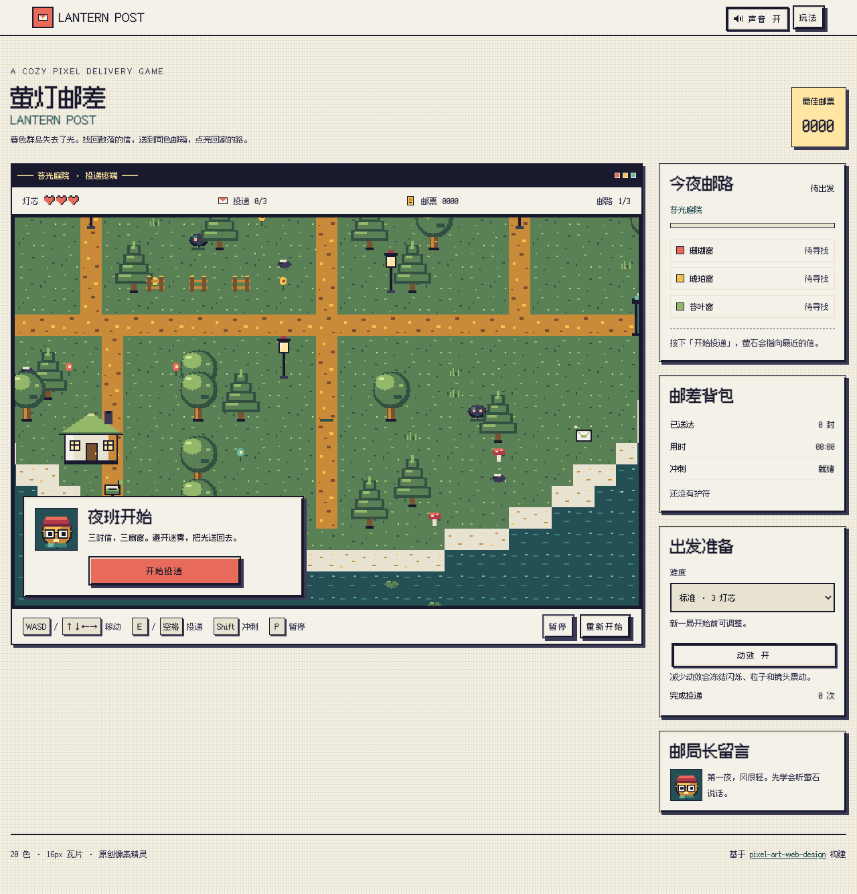
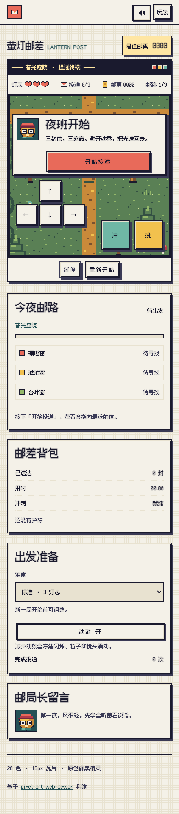

# 萤灯邮差 · Lantern Post

这是使用 [pixel-art-web-design Skill](https://github.com/CacinieP/pixel-art-web-design) 构建的原创像素风投递游戏。暮色群岛失去了光，玩家扮演邮差，在三条邮路中找回 9 封信、投递到同色邮箱、选择护符升级，并点亮最终灯塔。游戏包含迷雾团敌人、冲刺无敌、灯芯生命、暂停、胜负结算、重新开始、本地最佳纪录、触屏方向键、程序化芯片音效与减少动效模式。

在线游玩：<https://caciniep.github.io/lantern-post/>（GitHub Pages，桌面与移动端均可）。





```bash
pnpm dev      # http://127.0.0.1:5173
pnpm test     # 核心规则与可达性测试
pnpm build    # 生成 sprites/ 与 dist/
```

操作：WASD / 方向键移动，E / 空格投递，Shift 冲刺，P 暂停。移动端使用画面上的方向键与「冲 / 投」按钮。

### 设计规格

- **风格基底**：Family B · 暖色瓦片，改为暮色群岛氛围；16×16 源瓦片，统一 2× 整数渲染。
- **四个滑块**：色阶深度 4；轮廓强度 70；动画预算 8（精灵循环、水波、萤石、粒子）；光源固定左上 45°。
- **网格**：布局单位 `--unit: 4px`，细节像素 `--pixel: 1px`，槽位 `--tile: 16px`，间距 8px / 16px。
- **色板（20 个不透明色）**：
  - 中性：`#1a1a2e` `#3a3a55` `#f4f1e8` `#e8e2d0`
  - 海雾：`#bfe3d0` `#6fb7a5` `#3d8078` `#245055`
  - 琥珀：`#ffe6a3` `#f2c14e` `#c98a3a` `#7a5230`
  - 珊瑚：`#ffb08a` `#e86a5a` `#b23a48` `#6e2740`
  - 苔叶：`#d4e39a` `#94b86a` `#5a8055` `#335043`
- **字体**：Fusion Pixel 12px proportional（简体中文，OFL，见 `fonts/OFL.txt` 与 `fonts/LICENSES/`）。
- **精灵**：`sprites/world-atlas.png` 与 `sprites/postmaster.png` 由 `tools/build-sprites.mjs` 从索引色像素绘制生成；Canvas 与 img 均使用 `image-rendering: pixelated`。
- **组件**：Panel、Button、ProgressBar、DialogBox、InventorySlot、HudBar、WindowChrome、SpriteFrame 均使用零模糊倒角与即时状态切换。
- **默认偏离**：为让游戏视口在桌面与手机保持整数像素缩放，精灵渲染采用 2× 而非 Family B 默认 4×；场景使用暮色冷海 + 暖琥珀/珊瑚，而非纯农场暖色；模态背景使用不透明墨色以避免额外混色。

## 开发与来源

Node.js 20+；不需要安装运行时依赖。也可使用 `npm run dev`、`npm test`、`npm run build`。

游戏与设计技能独立维护。本游戏由 CacinieP 在 Qoder / QoDuck 中使用 [pixel-art-web-design](https://github.com/CacinieP/pixel-art-web-design) 生成与迭代；技能安装请到该仓库。

游戏代码采用 [MIT](LICENSE)；字体采用 OFL，分发时保留 `fonts/` 中的许可文件。
